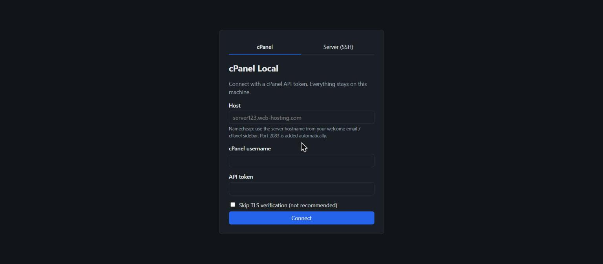
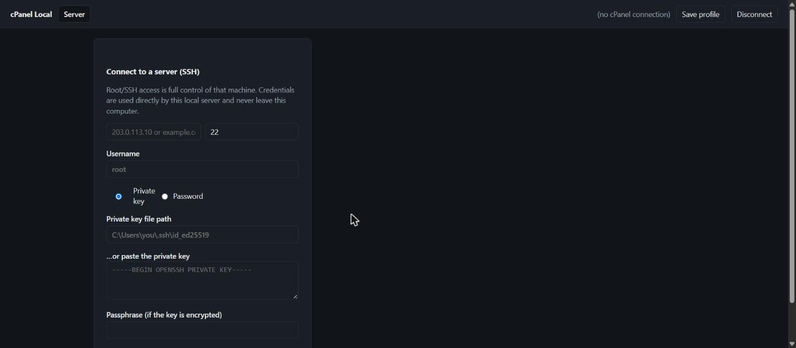
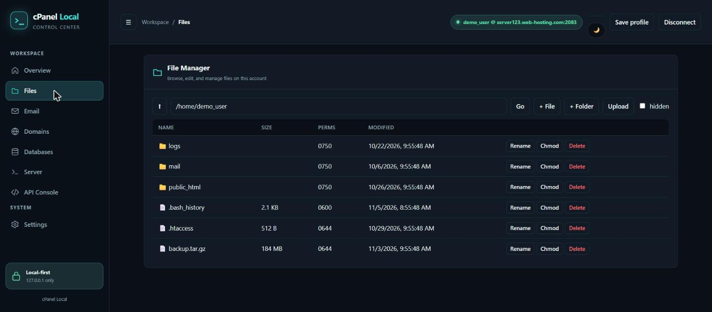
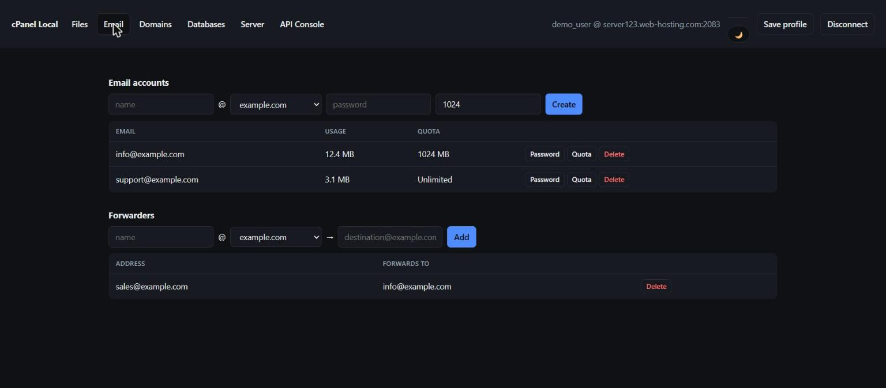
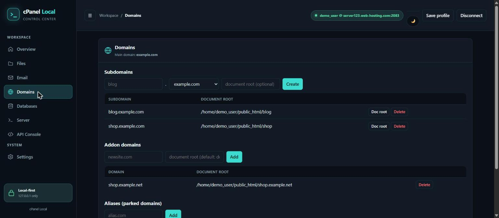
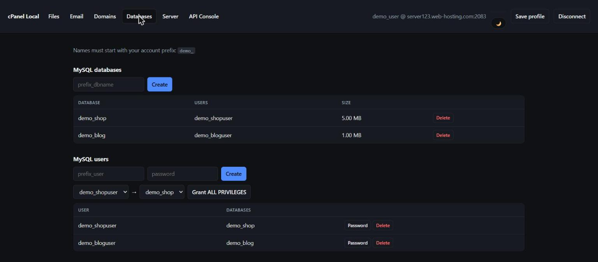
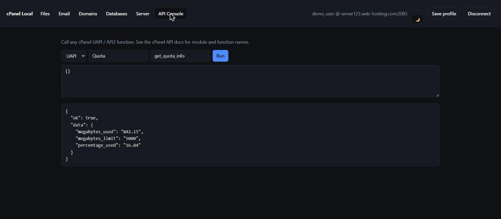

# cPanel Local

A small, **local-only** web app for two things that normally need two different tools:

1. Managing a cPanel hosting account (files, email, domains, databases) through its API, using a
   cPanel API token instead of your account password.
2. A direct **SSH connection** to any server — an interactive terminal plus an SFTP file browser —
   with no cPanel account required at all.

Everything runs on `127.0.0.1` on your own machine. Credentials live in server memory for the
life of the process and are never written to disk unless you explicitly ask it to (see
[Security](#security)).


## Contents

- [Why](#why)
- [Features](#features)
- [Screenshots](#screenshots)
- [Releases](#releases)
- [Requirements](#requirements)
- [Quick start](#quick-start)
- [Using cPanel mode](#using-cpanel-mode)
- [Using SSH mode](#using-ssh-mode)
- [Saved profiles (vault)](#saved-profiles-vault)
- [Project structure](#project-structure)
- [Security](#security)
- [Troubleshooting](#troubleshooting)
- [License](#license)

## Why

cPanel's own UI works fine, but it's slow for repetitive admin tasks and you have to use your main
account password (or juggle 2FA) just to, say, add an email forwarder. This app talks to cPanel's
UAPI/API2 directly with a scoped, revocable **API token**, in a small UI built for exactly the
handful of things you actually do often.

The SSH side exists because, once you're managing a server, you usually end up needing a terminal
and a file browser anyway — so it's built into the same tool instead of reaching for a separate SSH
client.

## Features

| Area | What you can do |
|---|---|
| Files | Browse, edit text files, create file/folder, upload (≤40 MB), rename, chmod, delete (to trash) |
| Email | Create/delete accounts, change password and quota; add/delete forwarders |
| Domains | Subdomains (create, change doc root, delete), addon domains (add/remove), aliases (add/remove) |
| Databases | Create/delete MySQL databases and users, change user password, grant ALL PRIVILEGES |
| Server (SSH) | Connect to any server with a password or private key; interactive terminal + SFTP file browser (browse, edit, upload, rename, chmod, delete) — independent of cPanel |
| API Console | Call any UAPI or API2 function directly, for anything the UI doesn't cover |

## Screenshots

> Populated with sample/demo data for illustration — no real account was connected to produce these.

| cPanel connect | Server (SSH) connect |
|---|---|
|  |  |

| Files | Email |
|---|---|
|  |  |

| Domains | Databases |
|---|---|
|  |  |

| API Console |
|---|
|  |

## Releases

Prebuilt standalone executables are published on the
[Releases page](https://github.com/apsaraaruna/cpanel-local/releases) — no Node.js install
required:

| OS | File |
|---|---|
| Windows (x64) | `cpanel-local-win-x64-vX.Y.Z.exe` |
| macOS (Apple Silicon) | `cpanel-local-macos-arm64-vX.Y.Z` |
| macOS (Intel) | `cpanel-local-macos-x64-vX.Y.Z` |
| Linux (x64) | `cpanel-local-linux-x64-vX.Y.Z` |
| Linux (arm64) | `cpanel-local-linux-arm64-vX.Y.Z` |

Download the file for your OS, then on macOS/Linux make it executable first:

```bash
chmod +x cpanel-local-*
./cpanel-local-*
```

On Windows, just double-click the `.exe` or run it from a terminal. Each release includes a
`SHA256SUMS.txt` you can check the download against. These executables bundle Node.js itself —
only [Requirements](#requirements) below applies if you'd rather run from source.

**macOS note:** these binaries are built on Windows and aren't code-signed, so Gatekeeper will
refuse to launch them as-is ("... is damaged and can't be opened"). Ad-hoc sign it yourself once,
after downloading:

```bash
xattr -dr com.apple.quarantine cpanel-local-macos-*
codesign --sign - cpanel-local-macos-*
```

## Requirements

- Node.js 18 or newer (only if running from source — see [Releases](#releases) for standalone
  executables that don't need it)
- A cPanel API token (for cPanel mode) and/or SSH access to a server (for Server mode) — you don't
  need both

## Quick start

```bash
git clone https://github.com/apsaraaruna/cpanel-local.git
cd cpanel-local
npm install   # installs ssh2, ws, and xterm.js (used by the Server tab)
node server.js
```

The terminal prints a one-time link:

```
cPanel Local is running (local only).
Open this link (works once):

    http://127.0.0.1:8787/?t=<one-time-token>

Press Ctrl+C to stop. Your API token is kept in memory only.
```

Open it in a browser. The link works **once** — it exchanges itself for an `HttpOnly` session
cookie, so refreshing the page afterwards is fine, but a second person opening the same link gets
rejected. Use a different port with `PORT=9000 node server.js`.

On load you'll see two tabs: **cPanel** and **Server (SSH)** — pick whichever you came for. They're
independent; you can use one, the other, or both in the same session.

## Using cPanel mode

1. In cPanel: **Security → Manage API Tokens → Create**. Copy the token — you only see it once.
2. In the app, on the **cPanel** tab, fill in:
   - **Host** — your server hostname, e.g. `server123.web-hosting.com` (from your host's welcome
     email, or cPanel's "General Information" sidebar). Port `2083` is added automatically.
   - **cPanel username**
   - **API token**
3. Click **Connect**. If you use your own domain as the host instead of the server hostname, you
   may hit a TLS error — the server hostname is what actually has a valid certificate.

Once connected you get the Files / Email / Domains / Databases / API Console tabs.

## Using SSH mode

On the **Server (SSH)** tab, click **Continue to SSH connect** and fill in:

- **Host** / **Port** (defaults to `22`)
- **Username**
- **Private key** (file path on this machine, or paste the key directly) **or Password**

Click **Connect**. The first time you connect to a given host, you'll see a dialog with its SSH
host-key fingerprint to confirm before trusting it — this is trust-on-first-use, the same model
OpenSSH's `known_hosts` uses. Verify the fingerprint against what your hosting provider shows you
(console, support page, etc.) before accepting it. If a trusted host's key ever changes afterward,
the app refuses the connection instead of silently proceeding, since that usually means either the
server was rebuilt or something is intercepting the connection.

Once connected you get a full interactive terminal (via [xterm.js](https://xtermjs.org/)) and an
SFTP file browser side by side, scoped to that one Server tab.

SSH mode works with or without a cPanel connection — you don't need a cPanel account to use it.

## Saved profiles (vault)

From an active cPanel connection, **Save profile** encrypts that connection (host, username, token)
into `vault.enc` using AES-256-GCM with a scrypt-derived key from a passphrase you choose. Next
time, unlock the vault with that passphrase from the connect screen to reconnect without re-pasting
the token. SSH connections are not currently saved to the vault — see [Security](#security) for why.

## Project structure

```
server.js              Node http server: cPanel API proxy, SSH/SFTP, WebSocket terminal, sessions
public/
  index.html            App shell (connect screen + tabbed app view)
  app.js                 All client-side logic
  style.css               Styling
  vendor/xterm/            Vendored xterm.js + fit addon (no CDN, for a strict CSP)
scripts/
  build-release.js        Builds the standalone executables in Releases (`npm run build:release`)
```

Runtime data (SSH host-key trust store and the encrypted profile vault) is **not** stored in the
project folder — it lives in `~/.cpanel-local/` (`%USERPROFILE%\.cpanel-local\` on Windows), created
automatically on first run. That way it works the same whether you run from source or from a
packaged release executable (see [Releases](#releases)), and survives reinstalling/updating the app.

## Security

- Listens on `127.0.0.1` only; requests with any other `Host` header are rejected (stops
  DNS-rebinding attacks from a malicious web page).
- One-time launch link exchanges for an `HttpOnly; SameSite=Strict` session cookie; every API call
  also requires a matching `X-CSRF-Token` header.
- Your cPanel API token stays in server memory — it is never sent to the browser.
- Strict Content-Security-Policy (`default-src 'self'`, no inline scripts, no CDNs); all
  server-provided data is rendered with `textContent`, never `innerHTML`, so file/domain/user names
  can't inject markup.
- TLS certificate checks are on by default for cPanel connections; plain HTTP is refused except to
  localhost.
- Sessions auto-expire after 1 hour idle. Stopping the server (Ctrl+C) clears everything held in
  memory.
- For extra safety, give your cPanel API token an expiry date and delete it when you're done.
- SSH host keys use trust-on-first-use (above). Fingerprints are stored in
  `~/.cpanel-local/known_hosts.json` — delete that file to forget a trusted host.
- SSH credentials (password, private key, passphrase) are sent to this local server and used
  directly to connect. They're kept in server memory only and are **never** written to disk — the
  vault currently only stores cPanel connections, not SSH ones. Root/administrator SSH access is
  full control of that machine; treat it accordingly.

## Troubleshooting

- **"This launch link was already used or is invalid."** — Each link works once per server start.
  Restart the server (`node server.js`) to get a fresh one.
- **TLS error connecting to cPanel** — use the server hostname (e.g. `server123.web-hosting.com`),
  not your own domain; only the server hostname is guaranteed to have a matching certificate.
- **"host key CHANGED" warning on SSH connect** — the app is refusing to connect because the
  server's key doesn't match what's stored in `~/.cpanel-local/known_hosts.json`. This is a
  deliberate man-in-the-middle guard, not a bug. If you rebuilt the server yourself and are sure
  it's safe, delete the corresponding entry from that file and reconnect.
- **Port already in use** — run with a different port: `PORT=9000 node server.js`.

## License

ISC — see [LICENSE](LICENSE).
